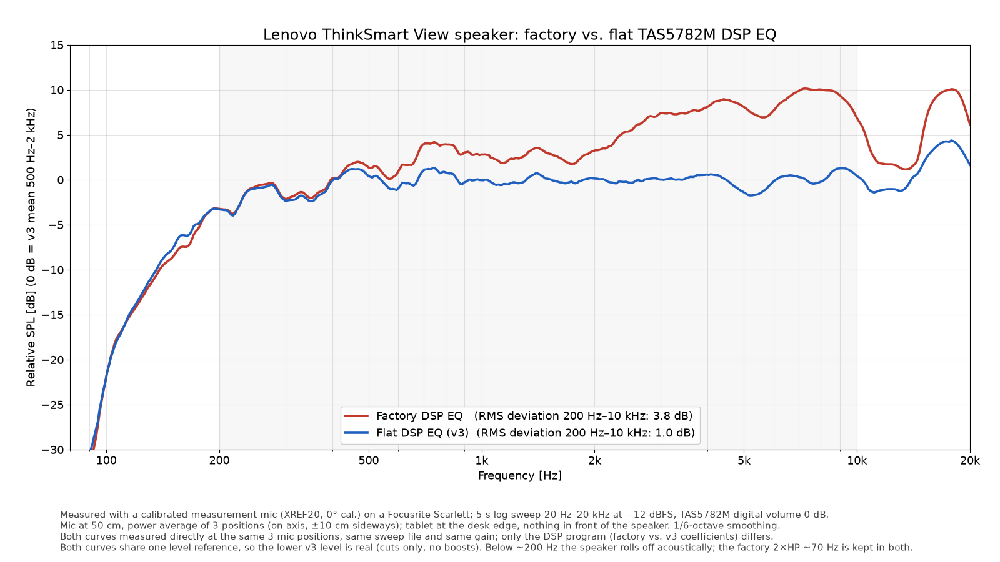

# Audio

## Speaker (TAS5782M)

On 7.3 (`tsv73/device`, tag `tsv-v7.3.0-r8`) the amplifier is driven by the
tas2781 driver with Felix Kaechele's TAS5782M support: his six commits from
the `tas5782m-tas2781` branch, a DT commit for this board and one commit of
ours that caps the digital volume at 0 dB. On 7.1.3 and 7.0.9 it is still the
stopgap in the tas5805m driver ("ASoC: tas5805m: add TAS5782M support from
Felix Kaechele's tree"), whose volume control uses the TAS5805M register
layout.

- **Firmware.** tas2781 loads an RCA file,
  `qcom/msm8953/lenovo/cd-18781y/tas5782mRCA1.bin` (DT `firmware-name`).
  Felix's `tas5782m-rca.py` (commit 98432449 in his
  [postmarketos-vendor-lenovo-cd-18781y](https://gitlab.com/kaechele/postmarketos-vendor-lenovo-cd-18781y)
  repository) builds it from the vendor register-pair DSP blob,
  `tas5728m_dsp_lenovo_cd-18781y.bin`. We do not ship either file.
- **Reset.** PDN# is inverted on the board: the amplifier runs while GPIO 44 is
  low, so the DT has `reset-gpios = <&tlmm 44 GPIO_ACTIVE_LOW>`. With
  `GPIO_ACTIVE_HIGH` the amplifier stays in power-down and NACKs I2C.
- **Volume.** "ASoC: tas2781: limit the TAS5782M digital volume to 0 dB":
  the control `Speaker Digital Volume` runs 0..207 in 0.5 dB steps, 0 is mute
  and 207 is 0 dB (register 0x3d = 0x30). Above 0 dB the speaker distorts in
  the bass (below). Set it to 207 and control the level in PipeWire.
- **Config.** `CONFIG_SND_SOC_TAS2781_I2C=m`. The UCM `HiFi.conf` from Felix's
  repository matches the new control names.

### Flat DSP EQ

The vendor DSP program has four EQ biquads (book 0x8c, page 0x16, registers
0x1c, 0x30, 0x44, 0x58) that tune the speaker for speech: measured against
the flat version below, it is about 2.5 dB louder at 1 kHz, 7 dB at 3 kHz
and 9 dB at 5-7 kHz. Two high-pass biquads (0x15/0x6c and
0x16/0x08, about 70 Hz) protect the speaker. We replaced the four EQ biquads
with cuts computed from measurements, and left the high-pass biquads as they
are:

| Biquad | Cut |
|---|---|
| `8c:16:1c` | -3.6 dB at 1.1 kHz |
| `8c:16:30` | -7.9 dB at 2.8 kHz |
| `8c:16:44` | -7.4 dB at 7.9 kHz |
| `8c:16:58` | -10 dB at 17 kHz |



Measured with a calibrated XREF20 microphone at 50 cm, averaged over three
positions, tablet at the desk edge. The deviation from 200 Hz to 10 kHz drops
from 3.8 dB RMS to 1.0 dB. Both curves are measured directly, at the same
positions with the same sweep. Below about 200 Hz the
speaker rolls off acoustically. The EQ has cuts only, so the flat version is quieter: about
3 dB in the speech band.

[`tools/tas5782m-eq-patch.py`](../tools/tas5782m-eq-patch.py) replaces
coefficients in the register-pair blob (five 32-bit words per biquad: b0,
b1/2, b2, -a1/2, -a2, Q1.31). Then build the RCA file from the result:

```sh
tools/tas5782m-eq-patch.py tas5728m_dsp_lenovo_cd-18781y.bin flat.bin \
  8c:16:1c=7af925f9,8fe71250,6765aa63,7018edb0,9da12fa4 \
  8c:16:30=6fcc49f9,a1d37f5c,59f31d54,5e2c80a4,b64098b3 \
  8c:16:44=6e037727,cecf4e1e,5340a554,3130b1e2,bebbe385 \
  8c:16:58=62806a40,32dcc60a,47379273,cd2339f6,d648034d
tas5782m-rca.py build flat.bin tas5782mRCA1.bin
```

Measured on unit 5; the same EQ runs on all five units.

**Louder than 0 dB.** The bass distorts at full scale already at 0 dB: with
the factory EQ, THD (H2-H5) at 0 dBFS is 18 % at 100 Hz, 6.0 % at 150 Hz and
2.3 % at 200 Hz. At +3 dB (register 0x3d = 0x2a, flat EQ) sweeps at -12 to
0 dBFS showed no compression, but the THD rises to 24 %, 7.6 % and 3.4 %.
From about 400 Hz up it is around 1 % or less in both cases (two different
placements, so compare the trend, not single values). A steeper high-pass (about 130 Hz instead of 70 Hz) would allow
+3 dB; we kept 0 dB.

**Speech vs. music.** The flat DSP EQ is the base. A voice or music profile
goes on top as a PipeWire filter-chain (the builtin `bq_*` filters, or
`bq_raw` with the factory coefficients to get the vendor sound back).

`soc-qcom-msm8953`: raise the UCM `provider_priority` (we use 10). Otherwise
apk may pick `alsa-ucm-conf-unisoc-ums9230`.

### Music profile with psychoacoustic bass

Below about 150 Hz the speaker gives little output, and what it gives
distorts (see above). For music we replace real bass with its harmonics:
Calf Bass Enhancer adds harmonics of everything below 150 Hz, and a 120 Hz
high-pass after it removes the fundamentals. The ear fills in the missing
fundamental, so bass lines stay audible while the cone stays out of the
distorting range. Around it: -3 dB preamp for headroom, +3 dB at 200 Hz,
+2.5 dB at 4.5 kHz and -2 dB at 9 kHz, mono. The values were picked by ear
from several variants on the flat EQ above.

The chain is a separate sink that plays into the echo canceller, so echo
cancellation keeps working during music. It has a low priority, so it never
becomes the default sink; only the media player is routed to it, and speech
and alarms stay on the flat curve. `/etc/pipewire/pipewire.conf.d/62-music.conf`:

```
context.modules = [
    { name = libpipewire-module-filter-chain
        flags = [ nofail ]
        args = {
            node.description = "Speaker (music)"
            media.name = "Speaker (music)"
            filter.graph = {
                nodes = [
                    { type = builtin name = pre label = linear control = { "Mult" = 0.708 } }
                    { type = lv2 name = be plugin = "http://calf.sourceforge.net/plugins/BassEnhancer"
                      control = { "amount" = 2.0 "freq" = 150.0 "drive" = 8.5 "blend" = 0.0 } }
                    { type = builtin name = mix label = mixer control = { "Gain 1" = 0.5 "Gain 2" = 0.5 } }
                    { type = builtin name = hp label = bq_highpass control = { "Freq" = 120.0 "Q" = 0.707 } }
                    { type = builtin name = low label = bq_peaking control = { "Freq" = 200.0 "Q" = 0.9 "Gain" = 3.0 } }
                    { type = builtin name = mid label = bq_peaking control = { "Freq" = 4500.0 "Q" = 1.4 "Gain" = 2.5 } }
                    { type = builtin name = top label = bq_peaking control = { "Freq" = 9000.0 "Q" = 1.5 "Gain" = -2.0 } }
                ]
                links = [
                    { output = "pre:Out" input = "be:in_l" }
                    { output = "pre:Out" input = "be:in_r" }
                    { output = "be:out_l" input = "mix:In 1" }
                    { output = "be:out_r" input = "mix:In 2" }
                    { output = "mix:Out" input = "hp:In" }
                    { output = "hp:Out" input = "low:In" }
                    { output = "low:Out" input = "mid:In" }
                    { output = "mid:Out" input = "top:In" }
                ]
                inputs = [ "pre:In" ]
                outputs = [ "top:Out" ]
            }
            audio.rate = 48000
            audio.channels = 1
            audio.position = [ MONO ]
            capture.props = {
                node.name = "music-sink"
                media.class = Audio/Sink
                priority.session = 1
                priority.driver = 1
            }
            playback.props = {
                node.name = "music-sink-out"
                node.passive = true
                target.object = "echo-cancel-sink"
            }
        }
    }
]
```

The Bass Enhancer is a stereo plugin, so the mono signal goes into both
inputs and the mixer sums the outputs back to mono. To route a player there,
match its stream in `/etc/pipewire/client.conf.d/62-music.conf` (this works
for clients such as GStreamer's `pipewiresink`; WirePlumber's `stream.rules`
only apply when it restores a stream):

```
stream.rules = [
    { matches = [ { media.name = "my-player" } ]
      actions = { update-props = { target.object = "music-sink" } } }
]
```

Packages: `calf-lv2` and `lilv` from the repository, plus
`pipewire-filter-graph-builtin` and `pipewire-filter-graph-lv2` from the same
1.6.11 overlay as the rest of PipeWire (see Noise suppression). The `nofail`
flag keeps PipeWire running if the plugin is missing; the player then plays
to the default sink.

## Full duplex and echo cancellation

Without the q6asm-dai fixes the ADSP died after a few stream restarts: a
second prepare after STOP opened the same ASM session again without closing
it, the ADSP refused that with error 9 (`ADSP_EALREADY`), and audio was dead
until reboot. Full-duplex use such as an echo canceller hit it within a few
cycles. Mainline has since fixed most of it. On 7.0.9 `tsv/device` carries
those five commits as backports (7.1.3 already has three of them), plus two of ours: tearing down a partially set up stream
(a failed media format used to leave the stream open) and checking capture
buffer queueing in prepare. Since r120 two more: the buffer token in data done
events from the DSP is checked before use, and capture reads are no longer
queued again after STOP. Tested on one unit with XRUN, drop/prepare and
hw_params changes for playback and capture.

With the fix, PipeWire's WebRTC echo canceller passed 20/20 full-duplex
cycles and removes about 40 dB of speaker echo. During loud playback it also
ducks near-end speech, as echo cancellers do with the speaker this close to the
microphones. `thinksmart-view-extras-echo-cancel` installs the configuration
(`60-echo-cancel.conf`: mono, WebRTC, default source and sink) and pulls in
`pipewire-echo-cancel` and `pipewire-webrtc`.

## Noise suppression

`thinksmart-view-extras-noise-suppression` adds RNNoise after the echo
canceller (`61-noise-suppression.conf`: a filter-chain with the
`noise_suppressor_mono` LADSPA plugin from `noise-suppression-for-voice`, voice
activity gate off). Its output, `noise-suppression-source`, becomes the default
microphone. If a default source was already chosen, WirePlumber keeps it; set
the new one with `wpctl set-default <id>`. The filter-chain module needs
`pipewire-filter-graph` and `pipewire-filter-graph-ladspa` built from the same
PipeWire as the rest; on v26.06 that is the 1.6.11 overlay in `temp/pipewire`,
not the 1.6.8 package from the repository. The module is loaded with
`nofail`, so PipeWire still starts if a piece is missing.

Measured on one unit with the same 30 s of speech at about 1 m, levelled to
the same speech level (noise in the pauses between words):

| Chain | Noise in pauses |
|---|---|
| one microphone | -36 dBFS |
| both microphones, mono downmix | -40 dBFS |
| + WebRTC (echo cancellation, noise suppression, gain control) | -57 dBFS |
| + RNNoise | -83 dBFS |

RNNoise and WebRTC together take about 5% of one core.

## Microphones

The two DMICs come up as one stereo capture device (DMIC1 left, DMIC2 right;
UCM `CaptureChannels 2`), so beamforming in userspace is possible. The echo cancellation setup above
uses mono, and the mono downmix of the two channels is already the best
two-microphone beam towards someone in front of the screen: the microphones
lie in the screen plane, at least 6.4 cm apart (the speaker reaches one of
them 187 us before the other), so speech from the front arrives at both at
once. The sum lowers the uncorrelated microphone noise by about 3 dB and
the speaker signal by 3-7 dB between 1 and 6 kHz before echo cancellation.
WebRTC no longer has a beamformer (it was dropped in webrtc-audio-processing
1.0). The two DMICs are quiet. Without echo cancellation we apply a software gain of
4 (`volume volume=4.0`) before encoding. With echo cancellation, do not add the
gain on top, since the canceller has its own gain control. Steered
beamforming with the two DMICs is not done; see above.
